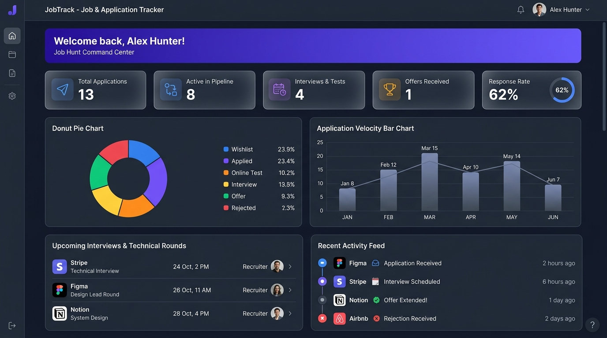
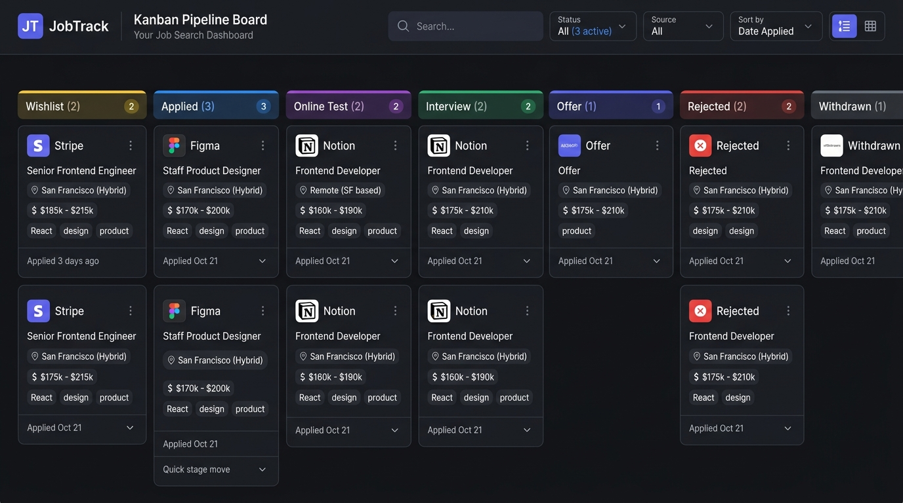
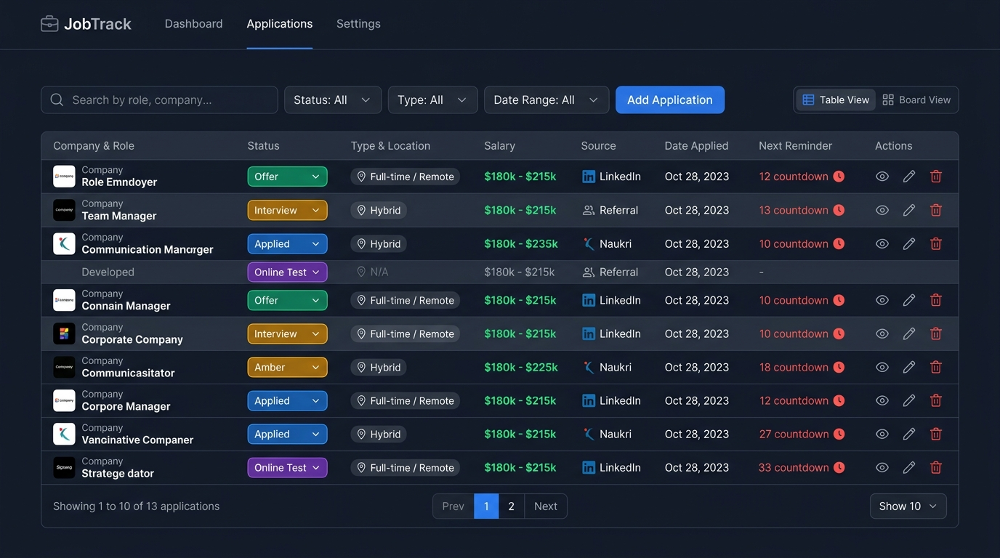
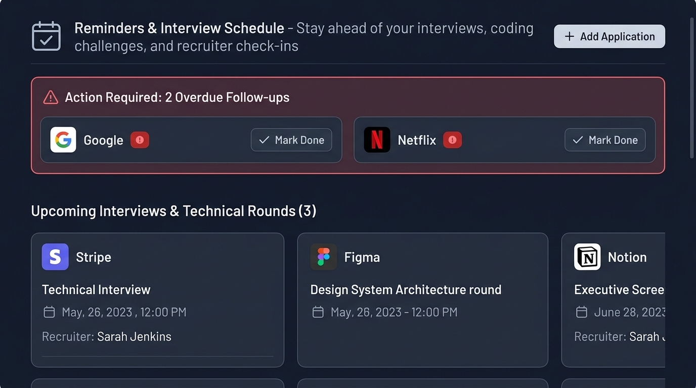

# JobTrack – Job & Application Tracker

<p align="center">
  <a href="https://job-track-job-application-tracker.vercel.app" target="_blank">
    
  </a>
</p>

<p align="center">
  
  
  
  
  
</p>

> **Live Production Website**: [https://job-track-job-application-tracker.vercel.app](https://job-track-job-application-tracker.vercel.app)  
> *Instant 1-click demo login included — explore 13 preloaded tech applications, live charts, Kanban board, and calendar sync!*

---

A modern, responsive, and feature-complete web application designed to help job seekers organize, track, and optimize every job application in one unified workspace.

Built with **React 19**, **Vite**, **Tailwind CSS v4**, **React Router v7**, **Recharts**, and an extensible **localStorage service layer**.

---

## 📸 Screenshots & Previews

### 1. Analytics & Metrics Dashboard


### 2. Interactive Kanban Pipeline Board


### 3. Filterable & Paginated Applications Table


### 4. Reminders, Upcoming Interviews & Overdue Follow-ups


---

## 🌟 Key Features

### 1. Complete Application Lifecycle Management (CRUD)
- **Comprehensive Fields**: Track Company, Job Title, Location, Job Type (*Full-time, Part-time, Internship, Remote, Contract*), Salary Range, Job Link, Date Applied, Pipeline Status, Source (*LinkedIn, Naukri, Indeed, Referral, Company Website, etc.*), Recruiter / Contact details (*Name, Role, Email, Phone*), and Notes.
- **Form Validation & Alerts**: Required field validation, link URL checking, and instant toast notifications upon save, update, or deletion.
- **Confirmation Modals**: Safeguards before destructive actions like deleting applications or clearing history.

### 2. 7-Stage Pipeline Workflow
1. **Wishlist**: Potential opportunities and target companies to apply to.
2. **Applied**: Application submitted, awaiting initial recruiter screen.
3. **Online Test**: Coding assessments, take-home challenges, or aptitude tests.
4. **Interview**: Technical, behavioral, system design, or onsite interview rounds.
5. **Offer**: Written or verbal offer received! *(Triggers celebration confetti)*.
6. **Rejected**: Application closed by the employer.
7. **Withdrawn**: Candidate decided to withdraw from the interview process.

### 3. Dual-View Mode: Interactive Kanban Board & Filterable Table
- **Kanban Board View**:
  - Drag-and-drop cards between status columns.
  - Column counter badges and highlighted drop targets.
  - Quick-move dropdown on each card for mobile/touch screens.
  - Color-coded status accents and salary chips.
- **Table View**:
  - Sortable by Date Applied, Company Name (A–Z / Z–A), and Salary (Highest / Lowest).
  - Clean pagination for managing hundreds of applications.
  - Direct links to job postings and recruiter contacts.
  - Status change dropdown directly in the row.

### 4. Advanced Search & Filtering
- **Multi-field Search**: Search across company names, roles, locations, notes, and recruiter names in real time.
- **Filters**: Filter by Pipeline Status, Job Type (*Full-time, Remote, etc.*), Application Source, and Date Range (*From / To*).
- **Sort Options**: Chronological, alphabetical, and salary ranges.
- **One-Click Reset**: Clear all filters with a single click.

### 5. Analytics & Metrics Dashboard
- **KPI Summary Cards**: Total Applications, Active in Pipeline, Interviews & Tests, Offers Received, and Response Rate %.
- **Status Breakdown Chart**: Interactive Recharts Donut / Pie chart visualizing candidate distribution across all stages.
- **Application Velocity Chart**: Recharts Area / Bar chart illustrating application velocity and monthly interview progression.
- **Upcoming Events & Reminders**: Highlighting upcoming rounds and urgent follow-ups.
- **Recent Activity Feed**: Real-time audit trail of status changes, new applications, and notes across all companies.

### 6. Reminders, Interviews & Overdue Follow-ups
- Set interview dates and times (displayed in chronological order).
- **1-Click Google Calendar Sync**: Export any scheduled interview directly to Google Calendar prefilled with recruiter contact details, company, role, and job link.
- **Universal .ics iCalendar Download**: One-click download of RFC 5545 `.ics` event files compatible with Apple Calendar, Microsoft Outlook, and desktop calendar apps.
- Set follow-up dates to keep in touch with recruiters.
- **Overdue Detection**: Red alert banners highlight check-ins that are overdue so no opportunity goes cold.
- One-click "Mark Completed" button to clear follow-ups.

### 7. Per-Application Detail & Activity Audit Trail
- Dedicated detail page (`/applications/:id`).
- Visual 5-step pipeline progress stepper.
- Recruiter contact card with email/phone links.
- **Interactive Activity History**: Chronological log of every status change, interview scheduling event, and timestamped progress notes.
- Quick note logger directly on the detail page to capture call takeaways and salary updates.

### 8. Import & Export Capabilities
- **Executive PDF Career Report**: Generate and print or save a vector-sharp, professional PDF summary report containing candidate profile, KPI summary metrics, upcoming interview schedules, and complete application inventory.
- **Export to CSV**: Download all application fields in spreadsheet-ready CSV format.
- **Import from CSV**: Upload external CSV spreadsheets with automatic column mapping and numerical salary parsing.
- **JSON Full Backup**: Lossless export including full timeline history, recruiter details, and notes.
- **JSON Restore**: Instant one-click restore.
- **Seed Realistic Data**: One-click button in Settings to reload 13 realistic tech applications (*Stripe, Figma, Notion, Vercel, Google, Netflix, Canva, Supabase, etc.*).

### 9. Multi-User Mock Authentication & Storage Isolation
- Mock authentication supporting multiple accounts.
- **Instant Demo Login**: One-click demo button to explore preloaded data as *Alex Hunter*.
- Each account's data is isolated under its own scoped LocalStorage keys (`jobtrack_v1_jobs_<userId>`).

### 10. Dark & Light Mode Theme Support
- Native dark mode tailored with slate/indigo color palette.
- Theme preference automatically persisted in `localStorage`.

---

## 🛠️ Tech Stack & Architecture

- **Frontend**: React 19, Vite
- **Styling**: Tailwind CSS v4, custom glassmorphism utilities
- **Routing**: React Router v7 (`BrowserRouter`)
- **Data Visualization**: Recharts (PieChart, BarChart, AreaChart, Tooltips)
- **Icons**: Lucide React
- **Celebration Effects**: Canvas Confetti
- **Storage Layer**: LocalStorage service layer (`src/services/storageService.js`, `jobService.js`, `exportImportService.js`) designed for seamless replacement with a REST or GraphQL API backend.

---

## 📂 Project Structure

```
├── src/
│   ├── components/
│   │   ├── common/              # Badge, ConfirmDialog, Modal
│   │   ├── dashboard/           # StatCards, StatusPieChart, TimelineChart, UpcomingWidget, RecentActivityWidget
│   │   ├── filters/             # FilterBar with search, sorting, and view toggle
│   │   ├── forms/               # JobApplicationModal with full validation
│   │   ├── kanban/              # KanbanBoard and KanbanCard with drag-and-drop
│   │   ├── layout/              # Sidebar, Header, and AppLayout
│   │   └── table/               # ApplicationsTable with pagination & row actions
│   ├── context/
│   │   ├── AuthContext.jsx      # Mock multi-user authentication & demo profile
│   │   ├── JobContext.jsx       # Global application state, filters, metrics, reminders
│   │   ├── ThemeContext.jsx     # Dark / light theme toggle
│   │   └── ToastContext.jsx     # Toast notification system
│   ├── data/
│   │   └── seedData.js          # 13 realistic sample job applications
│   ├── pages/
│   │   ├── DashboardPage.jsx    # Metrics, charts, upcoming events
│   │   ├── ApplicationsPage.jsx # Kanban / Table toggle with filters
│   │   ├── ApplicationDetailPage.jsx # Details, recruiter info, timeline history
│   │   ├── RemindersPage.jsx    # Upcoming interviews & overdue follow-ups
│   │   ├── SettingsPage.jsx     # Import/Export CSV, Backup/Restore JSON, Reset
│   │   └── LoginPage.jsx        # Auth portal with 1-click demo login
│   ├── services/
│   │   ├── exportImportService.js # CSV & JSON parsers and generators
│   │   ├── jobService.js        # Business logic & CRUD abstraction
│   │   └── storageService.js    # LocalStorage key-value wrapper
│   ├── types/
│   │   └── job.js               # Status definitions, color palettes, source lists
│   ├── App.jsx                  # Route definitions and provider wiring
│   ├── index.css                # Tailwind CSS v4 setup & base design tokens
│   └── main.jsx                 # Application entry point
├── package.json
└── vite.config.js
```

---

## 🚀 Getting Started

### Prerequisites
- Node.js (v18 or higher recommended)
- npm (v9 or higher)

### Installation
1. Clone or open the repository folder:
   ```bash
   cd "JobTrack – Job & Application Tracker"
   ```

2. Install dependencies:
   ```bash
   npm install
   ```

3. Start the local development server:
   ```bash
   npm run dev
   ```

4. Open your browser and navigate to:
   ```
   http://127.0.0.1:5173/
   ```

### Production Build
To create an optimized production bundle:
```bash
npm run build
npm run preview
```

---

## 📸 Screenshots & UI Previews

### 1. Dashboard Overview
- Summary KPI Cards (*Total Applications, Active, Interviews, Offers, Response Rate %*)
- Recharts Donut Pie Chart of status distribution
- Monthly velocity Bar/Area chart
- Upcoming interviews and overdue alerts panel

### 2. Applications Pipeline (Kanban Board)
- 7 drag-and-drop columns from Wishlist to Offer/Rejected
- Instant status badges, salary tags, and touch-friendly stage selectors

### 3. Applications Table View
- Sortable table with search, status filters, source badges, and quick row actions

### 4. Application Details & Audit Trail
- 5-step visual pipeline progress stepper
- Recruiter contact details card
- Chronological timeline recording status transitions and custom interview notes

---

## 🔮 Future Improvements

1. **Backend Integration**: Replace the `storageService.js` layer with a Supabase / PostgreSQL or Node.js/Express REST backend.
2. **Email Integration**: Automated follow-up email drafts via Gmail / Outlook API.
3. **Resume & Portfolio Attachment**: Upload PDF resumes and cover letters linked directly to specific applications.
4. **Browser Extension**: A Chrome extension to auto-fill and import job postings directly from LinkedIn and Indeed into JobTrack with one click.
5. **Calendar Sync**: Export interview schedules directly to Google Calendar or iCal format (`.ics`).
